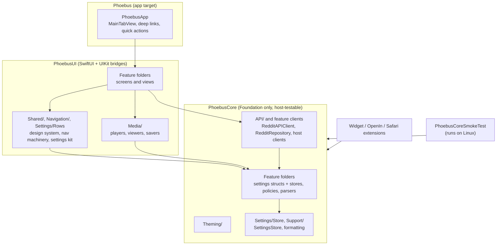
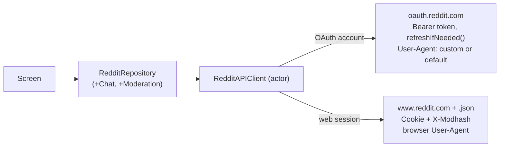
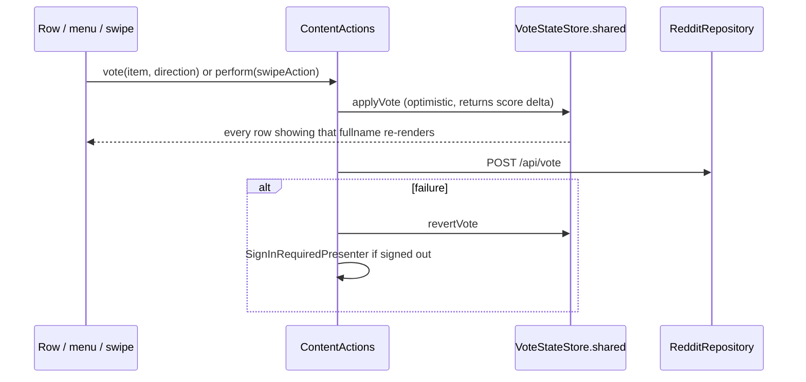
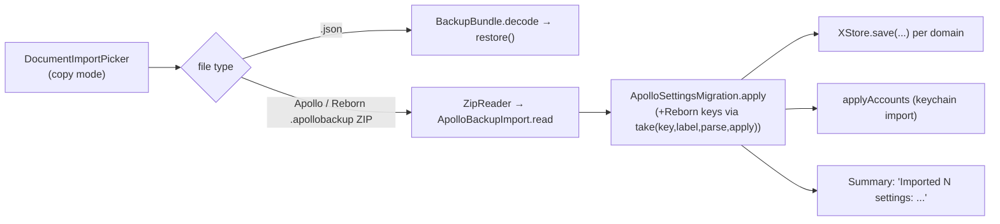

# Component reference

One entry per notable sub-component of the app: what Apollo / Apollo
Reborn feature it reproduces, where it lives, what it depends on, and
where it knowingly differs from the real app. Read this before the
source. Files are under `Sources/` unless stated. "UI" = `PhoebusUI`,
"Core" = `PhoebusCore`; both are grouped by feature, so a file's folder
follows its row's area (for example `UI/Feed/Rows/PostRow.swift`).

Companion docs: [gestures.md](gestures.md) (swipe internals) and
[intentional-differences.md](intentional-differences.md).

## Contents

- [Architecture at a glance](#architecture-at-a-glance)
- [Key flows](#key-flows): launch and auth, a request, a vote, a page swipe, a backup import
- Component tables: [1 shell](#1-app-shell-and-navigation), [2 feeds](#2-feeds-and-subreddits), [3 comments](#3-post-detail-and-comments), [4 media](#4-media-viewers-and-services), [5 social](#5-social-inbox-chat-modmail-moderation-profile-auth), [6 settings](#6-settings), [7 extensions](#7-extensions-and-shared)
- [Settings each area reads](#settings-each-area-reads)
- [Persistence map](#persistence-map)
- [Notification bus](#notification-bus)
- [Recipes](#recipes): add a setting, a settings screen, a pushing screen, a swipe action, a Reborn import key
- [Pitfalls index](#pitfalls-index)
- [Intentional differences](#intentional-differences-from-the-real-app)

## Architecture at a glance



Rules that follow from this shape:

- Anything expressible without UIKit (thresholds, parsers, gates,
  layout constants) belongs in `PhoebusCore` so the smoke suite can
  assert it on Linux. `PhoebusUI` types should be thin shells.
- Screens talk to Reddit only through `RedditRepository`. Nothing in
  `PhoebusUI` builds a `URLRequest` for reddit.com directly.
- Extensions depend on `PhoebusCore` only, and share data through the
  App Group container (`SharedFeedCache.appGroupID`), never
  `UserDefaults(suiteName:)` (silently nil under a free sideload).

## Key flows

### Launch and auth

```mermaid
sequenceDiagram
    participant App as PhoebusApp
    participant AS as AccountStore
    participant Auth as RedditAuthClient
    participant Tabs as MainTabView
    App->>AS: load accounts (keychain; file fallback in the simulator)
    alt no account
        App->>App: LoginScreen (OAuth or Universal OAuth web view)
        App->>Auth: exchange code, store credential
    end
    App->>Tabs: five NavigationStacks (Posts, Inbox, Profile, Search, Settings)
    Tabs->>Tabs: restore LastViewedSubredditStore destination
    Tabs->>Auth: /api/v1/me for Profile tab title and avatar
```

- Credentials: `KeychainCredentialStore`; the iOS simulator's keychain
  fails with -34018, so a container-local file stands in there.
- Web-session sign-in (chat, modmail, API-key-free accounts) swaps the
  transport, not the call sites: see "A request" below.

### A request



- `RedditAPIClient.baseURLOverride` exists only for pointing the app at
  a local mock server; nothing in the shipping app sets it.
- Decoders are lenient per item where Reddit is inconsistent
  (multireddits, flair richtext); a failed page keeps the list already
  on screen rather than blanking it.

### A vote (or save, or hide)



- Tapping the active direction toggles back to 0
  (`VoteStateStore.toggledDirection`).
- Save with Upvote on Save also upvotes. Hide removes the row through
  the caller's `SwipeActionHooks.onHide`.
- Do not keep a private `@State` copy of vote or save state anywhere;
  read `VoteStateStore` so the action bar, menus and rows agree.

### A page swipe (back or forward)

```mermaid
sequenceDiagram
    participant User
    participant PSC as PageSwipeController
    participant Nav as UINavigationController
    participant Fwd as ForwardNavigationStore
    User->>PSC: pan (PushPopGesturePolicy, arbiter, scroll exclusivity)
    PSC->>Nav: stand in as delegate; lock scroll views
    alt back
        PSC->>Nav: popViewController(animated: true)
        Nav->>Fwd: pushes the popped route to forward history
    else forward
        PSC->>Fwd: goForward() (re-push last entry)
    end
    PSC->>Nav: PageSwipeAnimator + interactive progress follows the finger
    alt commit
        Nav->>Nav: finish the transition
    else cancel
        Nav->>Nav: animate back, nothing changes
    end
    PSC->>Nav: hand the delegate back to SwiftUI
```

- A pushing screen must call `.apolloTracksForwardNavigation($binding)`
  or the forward swipe silently does nothing there.
- Tab changes clear forward history.
- Row swipes vs page swipes vs scrolling are arbitrated per sample
  (`ScrollGestureExclusivity`, `SwipeGestureArbiter`); details in
  [gestures.md](gestures.md).

### A backup import



- Keys deliberately skipped are listed in
  `ApolloSettingsMigration.isExcluded` and
  `ApolloSettingsMigration.notImported` (for example
  `ApolloRebornCustomThemes`), each with a one-line reason.

## 1. App shell and navigation

| Component | Files | What it is | Notes |
|---|---|---|---|
| App entry | `Phoebus/PhoebusApp.swift` | `@main`; shows `LoginScreen` or `MainTabView`; five root `NavigationStack`s (Posts, Inbox, Profile, Search, Settings); `phoebus://` and `apollo://` deep links (`DeepLinkDestination`, `PostLinkLoader`, `MultiredditLinkLoader`); home-screen quick actions | Profile tab title is the username; icon is the avatar (`ProfileTabAvatar`) |
| Notices | UI `ApolloToast`, `RedditRateLimitNotice`; Core `RedditRateLimitHold` | Top-of-screen error toasts; the API-Key-Free rate-limit notice (Reborn #1220/#1225) | |
| Tab bar | UI `LiquidGlassTabBar` | Native `TabView` with iOS 26 `tabBarMinimizeBehavior`; `HideHeaderOnScrollModifier` (Reborn `HideTopBarOnScroll`); hide style Left/Right/Fade/Down via `TabBarHideStyleProbe`, plus Reborn #1349's Minimize (the bar fades while a glass capsule, `MinimizedTabPillController`, shrinks from the bar's glass, found by Core `TabBarPlatter`, to a pill naming the tab, on Reborn's measured curves in Core `TabBarMinimizeStyle`; a tap on it expands the bar; progress is logged under category `tabbar`); a push, pop or stack replacement brings scroll-hidden bars back (Reborn #1349 navigation reveals: `NavigationRevealHooks` -> `TabBarScrollPolicy.navigationChanged`, decision in Core `TabBarNavigationRevealPolicy`); iPad bottom bar (`IPadTabBarBottom`, Reborn #387) | The real `UITabBar` supplies insets |
| Tab re-tap | UI `TabReselectionModifier` | Posts re-tap: scroll to top then pop one (#1153), the jump shared with the status-bar tap so it saves the position and offers the Return Button, taps ignored while it runs (#1360, `TabReselectScrollPolicy`, `ScrollToTopDelegateProxy.scrollToTopSavingPosition`); Search re-tap: scroll to top then focus field (#1190); Settings: pop to root | UIKit's own pop-to-root is vetoed in the delegate |
| Page swipes | UI `PageSwipeNavigation`, `InteractiveSwipeNavigationModifier`, `ForwardNavigation`, `UnsavedChangesGuard`, `ScrollGestureExclusivity`; Core `PushPopGesturePolicy`, `NavigationGestureSettings`, `UnsavedTextEdit` | Apollo's back/forward page swipes as a real interactive `UINavigationController` transition; forward history per tab. Phoebus's own addition: a screen with unsaved edits (`.apolloConfirmsDiscard`; the inline post and comment editors, Edit Profile) holds a back swipe and asks "Discard Changes?" | Design in [gestures.md](gestures.md). Settings tab is path-driven (`SettingsNavigation`) so it gets the same swipes |
| Update prompt | UI `AppUpdateCoordinator`, `AppUpdateSheet`, `CheckForUpdatesRow`, `UpdateInstallerRow`; Core `AppUpdateChecker`, `AppUpdatePolicy`, `UpdateSideloader`, `UpdateInstaller`, `UpdateHandoff`, `BuildChannel` | "In-App Update Prompt" (Reborn #1343): once a day on foreground, a half-height sheet (Update / Later / Skip this version) when the build's AltStore source has a newer build, handing off to AltStore, SideStore, Feather, FlareStore or the IPA; Privacy › Automatic Update Checks (`AutomaticUpdateChecks`), About › Check for Updates and Update Installer (Ask Every Time, or one installer opened directly; key `Phoebus.updateInstaller`) | Source and channel are Phoebus's (see intentional-differences); builds without `PhoebusBuildChannel` never check |
| Row swipes | UI `SwipeActionsModifier`; Core `SwipeAction`, `SwipeCommitPolicy` | Configurable short/long swipe per screen (Posts, Comments, Inbox), raw `UIGestureRecognizer`, per-sample row/page arbitration | Vote/save/hide all route through `ContentActions` |
| Quick switch | UI `QuickSwitchGesture` | Apollo's two-finger theme quick switch | |
| Glass | UI `ApolloGlass`, `GlassSearchField`, `NavigationActionsPill`, `CenterTitleBetweenButtons` | Liquid Glass surfaces gated on `LiquidGlass.isEnabled && canRenderGlass`; glass search field shared by Search, Subreddit Search and the subreddit switcher sheet; Reborn 3.7.0 collapsed nav action pill; Reborn 3.7.1 centred titles | Glass only renders on a device; the iOS simulator cannot draw it |
| Compatibility | UI `Compatibility` | Every `*IfAvailable` shim for iOS 18/26 API; min iOS 17 | the iOS 17 deployment target enforces it |
| App lock | UI `AppLockGate`, `OrientationLock`; Core `AppLockSettings` | Face ID/passcode lock with grace period; Portrait Lock | |
| Theming | UI `ThemeAppearance`, `ScaledFont`, `Color+Hex`; Core `Theme`, `ThemeCompiler`, `ThemeGallery*`, `ApolloPalette`, `ThemeAutoSwitch*`, `SolarTimes` | Compiled theme tokens applied to UIKit appearance; Apollo's point sizes that follow Dynamic Type (`apolloFont`); auto-switch by time or NOAA sunset (`SunsetLocator`) | Reborn's HCT palette engine is approximated |
| True Black Keyboard | UI `TrueBlackKeyboard`, `InterfaceSettingsScreen`; Core `TrueBlackKeyboardMode` | Reborn #1316 (`TrueBlackKeyboardMode`, Off / Dark Mode Only / Light Mode Only / Always, Interface → Display & Navigation): the system keyboard's backdrop is repainted pure black and a light-mode app gets the dark key set, installed once at launch from `ApolloAppDelegate`. The Core mode decides when to paint and when to use dark keys | Uses private UIKit classes (`UIKBBackdropView`, `UIKBRenderConfig`) looked up by name; a missing class or selector leaves the stock keyboard. Applies the next time the keyboard appears; only checkable on a device or simulator |
| Link routing | Core `LinkRouter`, `NitterInstances`, `RedditURLTarget`, `ShareLink*`, `ExternalBrowser`, `SafariDarkLoadingPolicy`; UI `InAppSafariView` | Which Reddit URLs open natively, share-link normalisation, external browser choice, in-app Safari. Reborn "Open via Nitter" (#1334): `LinkRouter.route` rewrites x.com / twitter.com page links onto the chosen Nitter instance ahead of the X-client step (keys `OpenTwitterLinksViaNitter`, `NitterInstanceHost`; picker list from status.d420.de, fetched on open, cached 15 min); tweet preview cards are a separate pipeline and unchanged | |
| Sign-in prompts | UI `SignInRequiredPresenter`; Core `SignInRequiredCopy` | Apollo's "Sign In to X" alerts | |
| Icons | UI `StockIcon`, `GlyphRenderer`, `ApolloIconImage`, `AppIconArtwork`, `LiquidGlassIconCards`; Core `StockGlyph`, `ApolloMenuIcon`, `AppIconOption`, `LiquidGlassIcon*` | Interface glyphs, by Apollo's asset names (`StockIcon("posts-points")`), and the app icon picker incl. Liquid Glass packs. See "Interface glyphs" below | No Apollo artwork. `Resources/StockIcons` holds only Reborn's two hub images (`apollo-reborn-options-icon`, `reborn-github`), to be replaced separately |
| Menus | UI `ApolloActionSheet`, `ApolloUIKitMenuButton`; Core `ApolloMenuSectioning`, `ActionMenuLayout`; UI `ActionMenusSettingsScreen` | Apollo's bottom action sheet; real `UIMenu` hosted in SwiftUI; Reborn Action Menus (#1131): each ••• menu is a list of id-keyed rows passed through `ActionMenuLayoutStore.arrange(_:for:)`; touch and hold on a feed post, a comment, or the title area of the post header (#1282) shows the same arranged rows. Customize Action Menus (#1368, built on #1300 by AcornElf): a saved order equal to the default counts as default, Reset Menu… offers Reset Order Only / Reset Order and Visibility, All Menus says where an action is hidden, and `remind-me` (Remind Me In…) is catalogued in Post, Post with Comments and Comment | Rows not in Reborn's catalogue ride with the catalogued row before them |

### Interface glyphs

- **Recipe table.** Core `StockGlyph` maps each glyph name to the frame
  Apollo's glyph filled (`frame`, so rows keep their layout) and a
  `Recipe`:
  - `.symbol(name, size:, weight:, rotation:)`: an SF Symbol (iOS 17.0
    names only), drawn natively by `StockIcon`.
  - `.asset(name, ink:)`: an open-source kit icon, a vector PDF in
    `Resources/Glyphs` fitted into the `ink` box. The PDFs are generated
    by `scripts/generate/gen-glyph-pdfs.sh` from the cropped SVGs in
    `Resources/Glyphs/source/` (stroke width set, colour black, viewBox
    cropped to the ink); licences in `Resources/Glyphs/LICENSES.md`.
  - `.composed(composition, size:, weight:)`: drawn in code from SF
    Symbols, paths and text: slashed up/down vote arrows, parent comment
    (bubble + chevron), collapse to root (chevron + bar), hide posts
    above (eye + chevron + bar), multireddit (circle with an m knocked
    out), subreddit wiki (book with an outlined serif W knocked out), the
    subreddit "r" tag (outline and solid, Phoebus's own drawing) and the
    upvote-ratio smiley (iOS 26 draws SF `face.smiling` filled).
  - `.text(string, ...)`: SpongeText "aAa" (SF Pro Rounded Light) and
    Text Faces "ಠ_ಠ".
  - `.orb(inner, rgb:)`: the Subreddits list's Home / Popular / All /
    Moderator badges, a white glyph on a disc in Apollo's orb colours
    (the moderator orb is Tabler `shield-star` at stroke 2.25). The only
    full-colour glyphs.
- **Drawing.** `StockIcon(name, size:)` draws SF recipes as
  `Image(systemName:)` at a fixed point size (no Dynamic Type), and
  everything else through `GlyphRenderer` into a cached template
  `UIImage`. A `size` other than the frame scales the whole glyph. The
  glyph sits on its bottom edge in baseline-aligned stacks.
  `StockIcon.image(_:)` (a plain `Image`, for SwiftUI menus) and
  `StockIcon.uiImage(_:)` (for UIKit and `UIMenu`) give the glyph as a
  template image at its frame; `ApolloIconImage` takes either a glyph
  name or an SF Symbol name.
- **Optical sizing.** A symbol's point size makes its ink match Apollo's
  ink along the longer side, measured at the symbol's real size (not
  scaled to a canvas), capped so the ink stays inside the frame. Glyphs
  drawn as images are clipped at the frame, so nothing may exceed it;
  no smoke check can measure SF ink on Linux, so check new sizes on the
  simulator. Line glyphs whose strokes read lighter than Apollo's go a
  weight up: the swipe actions are SF regular (compositions included,
  strokes 0.075 of the point size; light is 1/16). Menu rows, the post
  quick bar and the tab bar are light; the info row, composer, link
  buttons and inbox glyphs are regular.
- **Tab bar.** Both tab bars draw `tab-bar-*` glyphs as pre-rendered
  images (`LiquidGlassTabBar.tabLabel`), so the system can't apply its
  own fill. On the glass tab bar (`LiquidGlass.isAvailable`, iOS 26) the
  Inbox tab uses `tab-bar-inbox-glass`, SF `envelope.fill`; the other
  tabs and the classic tab bar are outline.
- **Smoke** (`checkStockGlyphs`): every name a view draws has a recipe
  and every recipe is drawn, only the orbs are full colour, the swipe
  glyphs keep the 34x30 slot, the bundled PDFs match the recipes and
  keep their source SVGs and `LICENSES.md`, the Font Awesome licence
  comment is kept, and `StockIcons` holds only Reborn's two images.

## 2. Feeds and subreddits

| Component | Files | What it is | Notes |
|---|---|---|---|
| Feed | UI `FeedScreen` (+ `FeedScreen+Menus`, `+Header`, `+Loading`), `FeedListingModel` (posts, paging, load state) | Subreddit/multi/home/popular/all listing: sorts, compact/large rows, the title's subreddit switcher sheet (`SubredditSwitcherSheet`), inline "Search" row, Gallery View entry, community highlights, "+N new" tracking, reached-end cell | Largest screen. `FeedSnapshotCache` keeps one-time fetches across pushes. A post just submitted is fetched by fullname and kept at the top through reloads until the listing has it (`SubmittedPosts`) |
| Post row | UI `PostRow` (+ `PostRow+Compact`, `+Large`), `TitleFlairLayout`, `TitleTranslation`, `SavedIndicatorBadge`, `RowHighlight`, `PostSwipePresenters` | Apollo's post cell: title + link flair as one text run, media, info row, saved wedge, press highlight (#1166), title translation | Metrics follow Apollo's own cell; see comments in `PostRow` |
| Media posts | UI `PostMediaView`, `InlineMediaBodyView`, `MutedVideoPlayerView`, `AnimatedGIFView`, `CachedAsyncImage`, `GalleryPager`, `ImgurAlbumView`, `SteamLinkView`, `LinkPreviewCard`, `PollView`, `DevvitWebView`, `YouTubePlayerView`, `VimeoPlayerView` | Dispatch by URL class; muted autoplay video with scrub/hold-speed/PiP; GIFs via AnimatedImage; galleries; Imgur albums; tweets; Steam; rich link previews; polls; Devvit | Autoplay policy in Core `AutoplayPolicy`/`VideoAutoplayPolicy`. Numeric-title link cards fall back to the site name. Captions follow the system caption setting (`YouTubeCaptions`). `YouTubePlayerView` loads Core `YouTubeEmbed`'s IFrame API page under an `https://<bundle id>` origin (YouTube refuses a youtube.com or empty referrer with 152-4/153) and turns a removed or embedding-disabled video (error 100/101/150/152/153) into a tap-to-open poster. The page runs with YouTube's controls off. `YouTubeEmbed.frameScript` is injected into the youtube.com embed frame (`forMainFrameOnly: false`): it hides the player's own chrome over the picture (`hiddenOverlaySelectors`, desktop and mobile players), controls the `<video>` element and reports its events as `video` messages, so the element is the source of truth for state, time, rate, sound and ads, with the IFrame API as the loader and the fallback while the element isn't found. `YouTubePlayerBridge` (one per video, from `YouTubePlayerRegistry`) sends `YouTubeEmbed.Command`s to that frame (or the API) and turns the `YouTubePlayerMessage`s into Core `YouTubePlayback`, so the inline post, the floating PiP card (`FloatingPiPController.show(youtube:)`) and the fullscreen viewer use the app's own `VideoControlPanel` and one web view that moves between them (Phoebus-only, see intentional-differences). Inline on the post screen it is dressed as a v.redd.it video: the picture leads the post under `apolloMediaFrame`, with `VideoMuteBadge`, `VideoScrubStrip` (Feed Video Scrubber), `VideoInlineSpeedMenu` and the `VideoSurfaceTap` routing from `VideoInlineChrome`, shared with `MutedVideoPlayerView`, and no control panel. While the video is paused, not yet played or ended, `YouTubeLogoBadge` (drawn in SwiftUI) sits bottom-left of the picture inline, in the fullscreen viewer and on the floating card, and opens the video on YouTube at the current time |
| Feed gallery gestures | UI `FeedGalleryPanYield`; Core `FeedGalleryPanPolicy` | "Swipe Past Gallery to Navigate" (Reborn #1271): a pan past the first/last image goes to the row's swipes | Gate recognizer on the TabView's paging scroll view |
| Subreddits root | UI `SubredditsRootScreen`; Core `FavoriteSubredditsStore`, `SubredditIndexTitle`, `SubredditCapitalization`, `HiddenModeratorSubreddits`, `FollowedUsersOrderStore`, `RecentlyVisitedStore`; UI `RecentlyVisitedSection` | Favourites (ordered), A-Z with index scrubber, multireddits, Following section, moderated subs, custom sections, Recently Visited (also on the Search tab; recorded by `FeedScreen` and `UserProfileScreen`); filter field as first row; edit mode | Multireddit fetch retries once and keeps the last list on failure |
| Subscription sync | Core `SubscriptionChange` (+ `.apolloSubscriptionsChanged`), `SubscribedSubredditsCache` | One notification for every subscribe/unsubscribe, so the header pill, menus and the list agree (Reborn #1264) | Posted by `RedditRepository.subscribe` |
| Subreddit header | UI `FeedScreen` + `SubredditIconView`, `SubredditCustomArtStore`, `ApolloSubredditSectionHeader` | Icon, banner, subscribe, Flair/Sidebar buttons; custom local banner/icon (#266) | |
| Quarantine opt-in | UI `QuarantineOptInView` (under the feed, thread and post-link errors), `FeedScreen+Loading` (`leaveQuarantine`); Core `QuarantineNotice`, `RedditRepository.setQuarantineOptIn`, `FeedErrorCopy` | Phoebus's "View Anyway" for a quarantined subreddit's 403 (Reddit's warning, confirmation, `POST /api/quarantine_option`, reload) and "Leave Quarantine" in the ••• menu, inspired by Continuum | The menu row shows only when `/about` loads with `quarantine: true`, i.e. once opted in |
| Sidebar, rules, mods | UI `SubredditSidebarScreen`, `SubredditRulesScreen`, `SubredditModeratorsScreen`, `SubredditNotificationsSheet` | Sidebar markdown, rules, public mod list (with avatars behind Show User Avatars), per-sub watcher notifications | |
| Multireddits | UI `MultiredditListScreen`, `MultiredditEditSheet`, `MultiredditSubredditsScreen`, `AddToMultiredditSheet`, `CopyMultiredditSheet`; Core `RedditMultireddit`, `MultiredditCopy` | List, create/edit, add/remove subs, custom icons (#799), Delete Multireddit (Subreddits row context menu), Copy to My Multireddits on someone else's multireddit (Phoebus-only) | Copy sends `to` so it lands on your account, numbered past your existing names |
| Search | UI `SubredditSearchScreen`, `PostSearchScreen`, `SubredditSwitcherSheet`; Core `SubredditSwitcherResults` | Subreddit search/subscribe, post search, and the feed title's quick-switcher: a "Subreddits" sheet (Reborn #1313) with a focused search field, favorites when empty, local then Reddit matches when typing, Return = Go. Picks push through `FeedScreen.jumpDestination` once the sheet is dismissed | The sheet's `List` does not install the scroll proxy, so it never posts the Hide Bars on Scroll notifications |
| Search history | UI `SearchHistorySections` (`RecentSearchesSection`, `SavedSearchesSection`), `PostSearchScreen`'s star; Core `SearchHistoryStore`, `SearchHistorySettings` | Phoebus addition: per-account recent queries per scope (all of Reddit or one subreddit; Reddit, Google, Kagi or Reddit Answers), saved searches (query, scope, sort, time) | Settings in Subreddits → Search |
| User search | UI `SubredditSearchScreen` (`usersSection`, `UserSearchRow`); Core `UserSearch`, `UserSearchResult`, `RedditRepository.searchUsers` | Phoebus addition: the Search tab's Users section while typing (`search?type=user` plus an exact `/user/<name>/about` lookup), avatar, karma and account age; blocked users hidden, suspended greyed; opened profiles go into recent searches | Three rows, then More Users |
| Google search | UI `GoogleSearchResultsView`; Core `GoogleSearch` | Reborn's "Search with Google" for Reddit results, from the search screen | Pure parts (query, URL, result parsing) in Core |
| Kagi search | UI `KagiSearchSession`, `KagiSessionLinkSheet` (+ `GoogleSearchResultsView`, `SearchEngineMagnifier`, the "Kagi Search" field in `AccountsAPIKeysScreen`); Core `KagiSearch` (URL, request, HTML parser, results), `KagiSession` (Keychain), `SearchEngine.kagi` | Reborn's Kagi as a third "Search With" engine (#1305): a plain GET of kagi.com/html/search with the Session Link as the `kagi_session` cookie, results hydrated from one `/api/info` batch, Any Time/Exact Words as `dr=`/`verbatim=1`, "Kagi Session Expired" card | Link only in the Keychain (`com.pendo324.Phoebus.kagi`), carried by `.apollobackup` exports; Reborn's `com.christianselig.Apollo.kagi` item imports. Fixtures in `Tests/Fixtures/kagi` |
| Reddit Answers | UI `RedditAnswerScreen`, `RedditAnswersSession`, `RedditAnswersSignInSheet` (+ `SubredditSearchScreen`, `SearchEngineMagnifier`); Core `RedditAnswers` (token and answer requests, `RedditAnswersTokenCache`, `RedditAnswerStream`, errors, quota), `ServerSentEventParser`, `JSONPatch`, `RedditAnswerContent` (document model and the RTJSON + `ra:*` render model), `RedditAnswerSourceInfo`, `SearchEngine.answers` | Phoebus-only fourth "Search With" engine: ask a question on Return and read Reddit's generated answer natively, with a live "thinking" line, numbered citation chips that open the cited post or comment, a Sources list read from one `/api/info` batch, follow-up questions, the questions-left line, Copy and Share | Web session only (the polls/Chat one): `POST /svc/shreddit/token` mints a bearer token, cached per account until a minute before it expires, then `POST answers.reddit.com/v1/answers/<uuid>` streams `text/event-stream` (`userQuota`, JSON Patch `patch` events, `success`/`error`); a 401 mints one fresh token, a 429 or quota error names the reset time. Every question, follow-ups included, is a new uuid. Only the `ra:*` elements the screen draws are declared in `supportedFeatures`; others degrade to text and links. Fixtures in `Tests/Fixtures/answers` are synthetic |
| Gallery View | UI `GalleryViewScreen`, `GalleryImageViewerScreen`; UI `WaterfallGrid`; UI `GalleryTileAutoplay`; Core `GalleryTile`, `GalleryPostMedia`, `GalleryAutoplaySettings`, `GalleryMuteStore` | Reborn's waterfall photo grid with tile autoplay (12-tile cap), fullscreen pager with hold-and-drag scrub and swipe-to-dismiss | |
| Filters | Core `ContentFilter`, `PostFilterRules`, `TagFilterSettings`, `RESFilterImporter`, `PostRule`/`PostRuleFeed`/`PostRuleStore`; UI `PostRulesScreen`, `PostRuleEditorScreen` | Keyword/user/subreddit/flair filters, Reborn Post Filters and Tag Filters, RES filter import; Phoebus-only Post Rules (score/comment/award ranges, NSFW/spoiler only, title regex, per-feed scope; inspired by Continuum) | All run in `FeedFilterPipeline`; `FeedListingModel` skips pages the filters empty (`FeedPaginationPolicy.shouldSkipFilteredPage`) |
| Read/recent | Core `ReadPostStore`, `RecentlyReadStore`, `RecentEntryPolicy`, `NewCommentsTracker`; UI `RecentlyReadScreen`, `HiddenPostsScreen` | Mark read / auto hide (incl. Popular and All), Recently Read, "N new comments" badge, Hidden Posts | |
| Community Highlights | UI `CommunityHighlightsCarousel`, `CommunityHighlightsWebFetch`; Core `CommunityHighlights`, `HighlightsCollapseStore` | Reborn 3.7.0 carousel; full mode scrapes up to 6 via a hidden web view | |
| Pagination | Core `FeedPaginationPolicy`, `PostSortMemoryStore`, `PostSizeMemoryStore`, `LastViewedSubredditStore` | Page-ahead threshold, remembered sort/size per sub, last viewed sub | |

## 3. Post detail and comments

| Component | Files | What it is | Notes |
|---|---|---|---|
| Post detail | UI `PostDetailScreen`, `PostDetailHeader`; Core `OwnPostChanges` | Header (media-first for image/video/gallery posts, title, flair, body, info row, action bar), comment list, find-in-comments, jump-to-next-comment button, AI summary card, sort, floating post tabs; your own post's Edit Post and Delete Post (with a "Delete Post?" alert) are catalogued rows of its ••• menu (`edit`, `delete`), so the header's touch and hold shows them too | |
| Comment tree | UI `CommentTreeScreen`, `CommentTreeStore` (`insertPosted`, Reborn #1196 fade-in; `resolveMoreStub` fades "N more replies" in, Reborn #1358); Core `CommentTree`, `PostedCommentResponse`, `CommentSortMemoryStore` | Tree build, collapse, `more` loading, depth colours, linked-comment context (`?context=`), sort memory (Live Update never persisted) | `rowGeneration` re-ids a toggled row so the List reloads it. `PostedCommentContext` gives a just-posted comment its OP mark and flair; edits and deletions are written into the loaded and cached trees |
| Comment row | UI `CommentRow`, `CommentFlairPill`, `MoreRepliesRow`, `DeletedReasonChip`, `AccountAgeBadge`, `TimestampLabel`, `EditedIndicator`; Core `CommentAgeFormatter` | Apollo's comment cell with Reborn metrics (15pt root, 12pt/depth bars), flair richtext, pinned/locked byline, deleted-comment reason chip and red tint, new-account highlight, tap-timestamp-for-date, edited pencil, Phoebus's Comment Age mode (since posted / relative to post / relative to parent, inspired by RedReader) | `CommentTreeContent` builds the age label; parents are looked up by fullname only in Relative to Parent |
| Own and followed user highlight | Core `AuthorHighlight`, `FollowedUsernames`; UI `AuthorHighlight+Color` (used by `CommentRow`, `PostRow`, `PostDetailHeader`) | Phoebus-only: your own name in the accent, followed users in orange, behind moderator/admin colours. `GeneralSettings.highlightOwnUsername` (on) / `highlightFollowedUsers` (off) | Followed set is the Subreddits list's `u_` subscriptions plus the friends list (`/prefs/friends`), kept in memory as two parts: `u_` names replaced by `SubredditListCache.save`, friends fetched once per account per launch and with each Subreddits refresh, and adjusted at once by Follow/Unfollow (`RedditRepository.followUser`) |
| Comment filters | UI `CommentFiltersScreen`, `CommentFilterEditorScreen` (Settings → Filters & Blocks → Comment Filters); Core `CommentFilter`, `CommentFilterStore`, `CommentFilterPolicy`, `applyingCommentFilters` | Phoebus-only, inspired by Continuum's comment filters: named filters with min/max score, excluded words (case-insensitive substring) and users, Hide or Collapse, all subreddits or a list. Applied by `CommentTreeStore.filtered` after blocked users, on the first build, live updates and every `more`/Continue-thread load | Own comments, the linked comment and its ancestors are never filtered; score bounds skip `score_hidden` and stickied comments; Hide wins over Collapse; a collapsed row shows `filterReason` |
| Thread scroll memory | Core `ThreadPositionSettings`, `ThreadPositionStore`, `ThreadPositionPolicy`, `RememberedPositions`, `ListViewport`, `TopVisibleRowPolicy`, `ScrollRestorePolicy`; UI `CommentTreeStore.saveThreadPosition`/`restoreThreadPosition`, `ThreadPositionTracking` (`ThreadScrollTracker`, `threadRowMarker`, `ThreadPositionBackToTop`; used by `PostDetailScreen`, `CommentTreeScreen`) | Phoebus-only "Remember Thread Position" (off, 20 threads): saves the topmost on-screen comment and its ancestors on leaving, backgrounding and every 15s; reopening scrolls there (or to the nearest shown ancestor) with a transient Back to Top pill | Read from UIKit: each row carries a hidden marker view; the list is the collection view above the markers (not the largest scroll view on screen), and only its `visibleCells` (not hidden) count, checked against the area below the bars, since `List` `onAppear`/`onDisappear` include prefetched and kept-alive rows. `scrollTo` gets close, then the content offset steps 0.8 screens at a time until the target's cell is realized and is aligned under the bars; a drag stops it. Nothing is saved after a restore until the reader drags. A focused comment link and Live sort never restore. `RememberedPositions`, `ScrollRestorePolicy` and `ThreadScrollTracker` are generic for other lists |
| Resume where I left off | Core `ResumeSettings`, `ResumeStore`, `ResumeSnapshot`, `ResumePolicy`; UI `ResumeCoordinator`, `FeedResumeContext`, `FeedScreen+Resume`, `apolloResumeTracksFeeds`; app `MainTabView` (posts tab `.task`, scene-phase and 15s saves) | Phoebus-only "Resume Where I Left Off" (off): saves the tab, the Posts tab's frontmost feed, its topmost post and the post open on it; a cold launch within 24h for the same account reselects the tab, pushes the feed, scrolls back to the post (fetching up to 3 pages) and reopens the post, whose comment position comes from Remember Thread Position | A link, widget, notification, quick action or Shortcut launch wins (scene connection options, `onOpenURL`, pending intents, checked again after 400ms). Feed rows reuse `ThreadScrollTracker` markers; until the restored feed is claimed, or after a restore until the first drag, saves write the restored place back. The snapshot is excluded from backups; the setting is included |
| Collapse animation | UI `CommentCollapseAnimation` | Swizzles the List layout so collapse/expand animate like Apollo (header rises, replies fan/fade) | Expanding about 26 or more rows at once snaps (SwiftUI `List` limit) |
| Voting/actions | UI `ContentActions`, `PostVoting`, `CommentVoting`; Core `VoteStateStore`, `Votable`, `VoteBreakdownCalculator`; UI `VoteBreakdownView` | The one optimistic vote/save/hide path; Upvote on Save; Reborn vote-count estimate | All screens' swipe handlers use `ContentActions.perform` |
| Composer | UI `CommentComposerScreen`, `ComposePostScreen`, `CrosspostScreen`; UI `MarkdownComposerField`, `QuickBarToolbar`, `GiphyPickerScreen`; Core `NativeCommentImages`, `TextFaces`, `SpongeText`, `CrosspostSuggestions`, `PostSubmitMarks` | Apollo's comment/post composers with Quick Bar, Giphy 8th button, text faces, native image comments (RTJSON); crosspost destination suggestions (Phoebus-only: recently visited plus `RedditRepository.fetchCrosspostableSubreddits`); Phoebus's NSFW/Spoiler switches for every post type (inspired by Continuum); title prefill with clear button, multi-line field and dismiss confirmation (Reborn #1290) | Poll compose in `PollComposeService`; posting-rule checks from the subreddit's post requirements (Core `PostRequirements`, `PostDraft`, `RedditRepository.fetchPostRequirements`; Phoebus-only) |
| Hide scores | Core `VoteCountSettings` (`postScoreText`, `commentScoreText`, `showsPostVoteEstimate`) | Phoebus-only "Hide Post Scores" / "Hide Comment Scores" (inspired by Continuum): numbers go, arrows and vote colours stay | Read by `PostRow`, `PostDetailHeader`, `CommentRow`, `ProfileCommentRow`, `MediaPagerScreen`, `CrosspostCardView`, `ShareCardView` |
| Mark NSFW / Spoiler | UI `PostMarking`, `PostMarkMenuButton`; Core `PostMark`, `PostMarkMenuPolicy`, `PostMarkChange` (+ `.apolloPostMarkChanged`); `RedditRepository.setMark` | Apollo's Mark/Unmark NSFW and Spoiler (`api/marknsfw`, `unmarknsfw`, `spoiler`, `unspoiler`): your own post's ••• menus, or the Moderator menu on others' posts where you moderate | Optimistic; the change is broadcast so the feed and the open post agree, and broadcast back with Apollo's "Error marking NSFW." toast on failure |
| Body rendering | UI `LongBodyText`, `BulkTranslatedText`; UI `SpoilerGatedBody`; Core `RedditMarkdown`, `MarkdownBodyCleanup`, `BodyParagraphs` | Chunked long bodies, Reddit markdown, fancy-pants cleanup (#405), spoiler gating, bulk translation | |
| Find in comments | UI `FindInCommentsBar`, `FindInCommentsFieldRow`; Core `CommentSearchEngine` | Reborn glass find: pinned field, n/m, ^ v pill | |
| Deleted comments | Core `DeletedCommentsSettings`, `ArcticShiftClient`, `RevedditClient`, `DeletedCommentsFallback`; UI `DeletedCommentsSettingsScreen`, `DeletedMoreCommentsExplanationScreen` | Reborn recovery via Arctic Shift (`api/comments/tree`); reason from Reddit's current body; Phoebus-only Reveddit fallback for comments Arctic Shift lacks; `ArcticShiftClient.fetchArchivedComments(ids:)` / `fetchArchivedComment(id:)` for single lookups (`api/comments/ids`) | Reveddit is asked once per thread, only when a deleted comment is still missing |
| Removed posts | Core `ArchivedPost`, `RemovedPostClassifier`, `RecoveredPostDisplay`, `RemovedPostRecoveryTrigger`, `ArcticShiftClient.fetchArchivedPost`; UI `RecoveredPostSection` | Phoebus-only: archived title/body/link/author of a removed post in post detail, gated by the Deleted Comments mode | One `api/posts/ids` request per post per session (answers cached in memory) |
| AI summaries | UI `AISummaryCardView`; Core `AISummaryCard`, `AISummaryLanguage`, `ApolloAIClient`, `OnDeviceSummarizer`, `AIModelCatalog`, `AIArticleDetector` | Apollo AI card, Tap to Summarize, provider/model catalogue, on-device summariser, summary Language (Reborn #1362: `AISummaryLanguage` leads every prompt with "You MUST respond in <language>." and is part of the summary cache key) | |
| Share as image | UI `ShareAsImageScreen`, `ShareCardView`; UI `ShareCardImageLoader`; Core `ShareCardFormatting` | Apollo's share card | |
| Comment insights | UI `CommentVoteInsightsSheet`; Core `CommentVoteInsightsClient` | Reborn author-only insights | |
| Post insights | UI `PostInsightsSheet` (Swift Charts); Core `PostInsights`, `PostInsightsParser`, `PostInsightsClient` | Phoebus-only: ••• › Insights on your own posts, from Reddit's `/poststats/` page over the web session | `post-insights` in the Action Menus catalogue |
| Floating post tabs | UI `FloatingPostTabsManager`, `FloatingPostTabsOverlay`; Core `FloatingPostTabsSettings` | Reborn floating tabs | |
| Other Discussions | UI `OtherDiscussionsScreen`, `OtherDiscussionsRow`; Core `OtherDiscussions`, `OtherDiscussionsSettings`, `RedditRepository.fetchOtherDiscussions` | Phoebus addition (inspired by Continuum's Other Discussions): other posts of the same link via `/duplicates/<id>`, from the post-detail ••• menu and a count row under the header | The row's count is the comments response's `num_duplicates` (`CommentsResponse.postDuplicateCount`), so it costs no extra request; the menu row is an uncatalogued extra after Crosspost in the Action Menus layout |
| Misc | UI `RemindMeScreen`, `ReportSheet`, `SelectTextSheet`, `TranslatorScreen`, `TextFacesPickerScreen`, `AllSubredditCommentsScreen`; Core `RemindMeScheduler`, `TranslatorURLBuilder`, `MutedThreadsStore`, `FollowThreadActivity` | Remind Me (local notifications, not push), report, select text, translator, all-comments feed, muted threads, Follow Thread Live Activity | |

## 4. Media viewers and services

| Component | Files | What it is | Notes |
|---|---|---|---|
| Fullscreen pager | UI `MediaPagerScreen`, `FullscreenImageViewer`, `VideoControlPanel`, `VideoTransport` (`AVPlayerTransport`), `VideoScrubSession`, `AVPlayerLayerView`, `VideoPlayerCache`, `LiveTextImageView`, `VideoDeblurinator`, `YouTubeFullscreenPage`; Core `VideoControlPanelTimeLabel`, `VideoHoldSpeedSettings`, `VideoPlaybackSpeeds`, `VideoPlaybackSettings`, `FeedVideoScrubberSettings` | Apollo's fullscreen media viewer: shared chrome, control panel, Live Text, deblurinator, hold-for-speed, swipe up for comments; Phoebus's Default Playback Speed (`AVPlayer.defaultRate`, set by `VideoPlayerCache`), Loop Videos and Seek Interval (`VideoPlaybackPolicy`, Continuum-inspired) | Reddit-hosted video needs a device; the iOS simulator cannot decode it. The control panel, scrub bar and time labels drive a `VideoTransport`: an `AVPlayer` through `AVPlayerTransport`, or a YouTube video through `YouTubePlayerBridge`. `VideoHoldForSpeed` and `VideoGestureScrubLayer` (`VideoGestures`) give both the hold-for-speed and scrub gestures |
| Floating PiP | UI `FloatingPiP`; Core `PictureInPictureSettings`; UI `PictureInPictureSettingsScreen` | Reborn in-app PiP: hand-off on scroll-away, drag/fling/pinch, controls, positions | |
| Saving | UI `PhotoAlbumSaver`, `AlbumImageSaver`, `GIFSaveService`, `SaveAllMediaJob`, `VideoDownloadService`, `ShareVideoExportService`; Core `AlbumSaveCapacity`, `SaveAllMediaSummary`, `VideoDownloader` | Save to "Apollo" album, Save GIFs as…, Save All Media (#1048), Download Video, Share as Video (#380) | |
| Image menu | UI `PressAnchoredImageMenu` | Long-press image menu anchored at the press point | |
| Hosts | Core `RedGifsClient`, `ImgurClient`, `ImgChestClient`, `GiphyClient`, `StreamableClient`, `VimeoURLParser`, `ImgflipURLParser`, `YouTubeURLParser`, `YouTubeEmbed`, `YouTubePlayback`, `SteamURLParser`, `TweetClient`, `OpenGraphClient`, `LinkPreviewCache`, `SportsClipHost`, `RedditVideoStream`, `RedditMediaUploadClient` | Third-party media resolution and uploads. `RedGifsClient` throws `RedGifsError` (deleted, not found, region-blocked, HTTP status, unreachable, image) and `RedGifsVideoView` shows its message, as Reborn's RedGIFs failure cards do (#1359) | |
| Inline media | Core `InlineMediaDetector`, `InlineMediaSettings`, `LinkPreviewSettings`, `LinkCardLimit`, `DevvitPostDetector` | Reborn inline media in bodies, rich link previews, Devvit detection | Phoebus-only Maximum Cards (`LinkPreviewSettings.maxCards`, default 5): `InlineMediaBodyView` shows the first N link cards and a "Show N more previews" row; media never hidden. See intentional-differences |
| Avatars | UI `AvatarView`, `ProfileTabAvatar`; Core `AvatarCache`, `AccountAgeCache` | Circular/rounded avatars per Shared Profile Picture Shape (#1136), cached | |
| Audio | Core `VideoAudioSession`; UI `Haptics` | Audio session hand-over, haptics matching Apollo's | |
| Feed video sound | UI `FeedVideoSound` | Only one feed video audible at a time (Reborn #1250) | |
| Archive | UI `ArchiveImageTombstone` | Reborn "image removed" check for Hidden & Deleted media | |

## 5. Social: inbox, chat, modmail, moderation, profile, auth

| Component | Files | What it is | Notes |
|---|---|---|---|
| Auth | UI `LoginScreen`, `WebSessionLoginScreen`, `WebAuthPopup`, `SignInTroubleshootingScreen`; `UI/Accounts/OAuth/*`; Core `RedditAuthClient`, `AccountStore`, `CredentialStore`, `WebSessionCredential`, `WebSessionRegistry`, `CustomAPISettings`, `SignInSessionPolicy` | Installed-client OAuth, Reborn Universal OAuth Sign-In (in-app web view), web-session login for chat/modmail, `window.open()` popups for Continue with Google/Apple hosted in a sheet by `WebAuthPopup` (Reborn #1342, #1372), multi-account, keychain with a file fallback in the simulator. Every sign-in (web-session login, Universal OAuth web view, ephemeral `ASWebAuthenticationSession`) runs on a throwaway cookie store so Reddit always shows its login form; Core `SignInSessionPolicy` decides the "Different Reddit Account" mismatch | Never uses Apollo's real client ID |
| Accounts | UI `AccountManagerScreen`, `AccountsAPIKeysScreen`, `CustomAPISettingsScreen`, `APIKeySetupGuideScreen`; `UI/Accounts/Manager/AccountManager.swift`; YouTube sign-in: `AccountsAPIKeysScreen`'s YouTube section, UI `YouTubeAccount` (shared data store, sign-in and cookie-import sheets), Core `YouTubeSession`/`YouTubeCookieImport` | Reborn account switcher (#1077), Accounts & API Keys, Custom API; a Phoebus-only YouTube sign-in for the player (see intentional-differences) | One app-wide API key; no per-account key editor |
| Session expiry | Core `RedditAuthClient` (`TokenRefreshOutcome`, `isSessionExpired`), `RedditAPIClient.send`; `MainTabView` alert | Reborn #1200: a 401 refreshes once and retries; a revoked refresh token prompts to sign in again | Posts `apolloSessionExpired` |
| Networking | Core `RedditAPIClient`, `WebBearerRouting`, `WebBearerCache`, `WebSubredditWrite`, `RedditRepository` (+Chat, +Moderation), `RedditModels`, `RedditThing`, `RedditMessage` | The facade every screen calls; lenient decoders. Web-session accounts send the moderator endpoints Reddit refuses over the cookie (removal reasons, mod user lists, mod invites, modmail mute) to oauth.reddit.com with their web bearer, shared with Chat (Reborn #1292, #1304, #1311), and private-message compose the same way (Phoebus only); flair and wiki saves go to `/api/<action>` with an `r` field (Reborn #1309) | |
| Inbox | UI `InboxListScreen`, `InboxScreen`, `ComposeMessageScreen`; Core `InboxCategory` | Boxes menu, category lists, compose (subject capped at 100 for PMs) | Inbox comment taps open the linked comment with context |
| Chat | UI `ChatListScreen`; UI `MessageBubbleRow` (PM and modmail bubbles; touch and hold offers Copy Text / Select Text, Reborn #1307); Core `MessageDraftStore` (Reborn #1207 drafts, Keychain), `RedditChatClient`, `ChatLiveSync` (long-poll `/sync`, merged room state; UI owner `ChatLive`), `RedditChatReactions`, `ChatSendQueue`, `ChatDateFormatter`, `ChatMessagesFilter`, `ChatUnreadNotifier`; UI `ChatBarkNotifier` | Native Reddit Chat via web session: list, threads, reactions, send queue, filters, Bark unread notifications (fed by `InboxBadge`'s poll) | See `docs/chat-sending-and-threads.md` |
| Modmail | UI `ModmailListScreen`; Core `ModmailWebService`, `ModmailConversation`, `ModmailWebConversation` | Modmail via web session; mute/unmute use the web bearer (Reborn #1311) | See `docs/modmail-web-session.md` |
| Mod tools | UI `ModQueueScreen`, `ModeratorLogScreen`, `ModeratorUsersScreen`, `ModNotesScreen`, `ModeratorInviteScreen`, `AutoModeratorScreen`, `SubredditTrafficScreen`; Core `ModQueueItem`, `ModeratorLogEntry`, `ModeratorListedUser`, `ModeratorUserList`, `ModNote`/`ModNoteRequest`, `RedditRemovalReason`, `RemovalNotifyKind`, `SubredditTraffic` | Queue (approve/remove/spam/ignore reports), removal reasons with Apollo's "Notify user via…" step (Public Sticky, Reborn's from-Subreddit #515, Mod Mail from Subreddit/You, private mod note), log, banned/muted users, invites, AutoMod config, traffic; a web-session account's removal reasons, ban/mute/approve, invites, accept and mod notes use its web bearer (Reborn #1292, #1304), per-user Mod Notes (Phoebus-only: list with type filter, add with label and 250-char counter, swipe to delete, linked post/comment opens natively; from the post and comment Moderator menus and a leading swipe on banned/muted/approved rows; `modnote` OAuth scope) | Comment-row mod actions in `CommentRow` remove without the reason flow; Mod Notes isn't in the feed hold menu and shows no label badge by usernames (`/api/mod/notes/recent` unused) |
| Profile | UI `UserProfileScreen`, `ProfileListingView`, `HiddenContentScreen`; Core `ProfileLayoutSettings`, `IdentityHeaderLayout`, `ProfileBannerURL`, `RedditTrophy`, `BadgeBook`, `CommunityAchievements` (+ UI `CommunityAchievementsBand`), `SavedCategory`, `SocialLinkService`, `HiddenContentFinder` | Immersive/Compact/Native layouts, banner viewer, badge book, per-community achievements on an author's profile opened from a post or thread (web session; `UserCommunityAchievements`, cached per user and subreddit), saved categories, social links, Hidden & Deleted (#1137), "..." on own profile | |
| Edit Profile | UI `EditProfileScreen`, `ProfileAvatarWebScreen`, `SocialLinkEditorSheet`, `ProfileImagePreparer`; Core `ProfileAvatarWeb`, `WebSessionCookies`, `ProfileSettings`/`ProfileEdits`/`ProfileEditLinks` (`ProfileEdit.swift`), `ProfileImageSpec`, `ProfileImageUploadResponse` (`ProfileImage.swift`), `ProfileSocialLinkType`/`ProfileSocialPlatform`/`SocialLinkDraft`/`SocialLinkEdits` (`ProfileSocialLinks.swift`), `ProfileSettingsPage`, `ProfileSocialLinksService`, `MultipartForm`, `RedditRepository+ProfileEdit`, `RedditAPIClient.postMultipart`, `WebBearerRouting` | Phoebus's own native editor for your profile's banner, display name (30), about (200), Allow People to Follow You, NSFW, social links and Profile Visibility; pushed from "Edit Profile" in your profile's "..." menu. Reads `about/edit` of `u_<name>`, writes it back through `site_admin` with every setting resent; the banner goes through `upload_sr_img`/`delete_sr_banner`. Allow People to Follow You is the account preference `enable_followers`, read from and PATCHed to `/api/v1/me/prefs` (`ProfileFollowPreference`; `site_admin` ignores `accept_followers`). A display name over 30 makes `site_admin` answer HTTP 500, so `saveProfile` refuses it first (`ProfileEditRefusal`). A web-session account sends these five to oauth.reddit.com with its web bearer. Social links (up to 5) are read from reddit.com/settings/profile with the web-session cookie (`ProfileSettingsPage` parses the page's `initialState`: current links with ids, and `socialPlatforms`, which sets each platform's fields: a username up to 30, or display text up to 21 and a URL up to 250; `ProfileSocialPlatform.builtIn` covers the 26 types when the page can't be read), and changed through the Shreddit GraphQL endpoint (`SetProfileSocialLinks`, `DeleteProfileSocialLinks`), applying on Save with the rest; without a web session the section is read-only with a web sign-in button. Profile Visibility (`ProfileVisibility`, `ProfileVisibilityService`, `ProfileVisibilityCommunitiesSheet`) is read from the same page (`identity.preferences`, `preferencesState` locks, `redditor.activeSubreddits`) and staged beside the rest: Show all / Customize (a community picker) / Hide all, NSFW and Followers switches. Saving sends the whole set with `UpdateProfilePrivacyPreferencesV2` and the follower count with `UpdateAccountPreferences` (`showFollowersCount`), each only if changed; without a web session the section only offers the web sign-in | The Avatar row pushes `ProfileAvatarWebScreen`: reddit.com's profile settings (a photo or the avatar builder) in a web view on a private non-persistent data store seeded with the account's web-session cookies (`WebSessionCookies`, shared with `ChatTokenWebMinter`); `ProfileAvatarWeb` is the URL policy (a login redirect or 401/403 offers the web sign-in again; logout is blocked; other sites open in Safari). Without a web session it offers the one-time web sign-in first, with an "Open in Safari" fallback; closing the page refreshes the profile header and avatar cache. Unsaved edits hold a back swipe (see Page swipes). See `docs/intentional-differences.md` |
| User tags | UI `UserTagPill`, `UserTagEditorSheet`, `UserTagsSettingsScreen` (`Profile/UserTags/UserTagViews.swift`; Settings → Filters & Blocks → User Tags); Core `UserTags`, `UserTag`, `UserTagColor`, `UserTagStore` | Phoebus-only, inspired by Continuum's user tags: a local label + palette colour per user, shown as a pill after the name in `CommentRow`, `PostRow` (Compact by-line and info-row author, Large by-line), `PostDetailHeader`, the profile header (Immersive/Compact) and inbox `MessageRow`. "Tag User…" ("Edit Tag…" once tagged, `UserTagMenuItem`) in the profile •••, comment ••• (`tag-user`, travels with Copy Username in Action Menus), feed post ••• (in `subscribe-actions`, after Copy Username), inbox message ••• and the post header's author menu | Keyed by lowercased name; every pill reads one shared `@Setting(UserTags.self)` box, so a row costs a dictionary lookup and rows refresh on change |
| Local Saved | Core `LocalSavedRecord`, `LocalSavedPolicy`, `LocalSavedStore`, `LocalSavedLiveStatus`, `LocalSavedSettings`, `RedditRepository.walkSavedListing` / `fetchInfoItems`; UI `LocalSavedScreen`, `ProfileListingView` (Kept Locally row), `ContentActions.toggleSave` | Phoebus-only: a snapshot of every save made in the app; items a complete Saved listing no longer has show under Saved > Kept Locally with a Removed/Deleted badge and archived comment bodies | Records live in defaults per account (`com.pendo324.Phoebus.localSaved.<account>`, capped at 2000) so settings backups carry them |
| Notifications | UI `NotificationsSettingsScreen`, `NotificationBackendSettingsScreen`, `WatcherComposerScreen`, `PushNotificationCoordinator`; Core `PushNotificationClient`, `PushDeviceIdentity`, `PushRegistrationState`, `NotificationBackendSettings`, `NotificationSettings`, `SubredditWatchStore`, `TrendingSubredditTitleParser` | Self-hosted apollo-backend over APNs (when the signing has push) or Bark; watchers; the app icon badge | `PushNotificationCoordinator` sets the icon badge in the foreground, from a background refresh (`BGAppRefreshTask`, not available in the simulator), and APNs pushes carry it themselves; notification taps open the thread or inbox |

## 6. Settings

| Component | Files | What it is | Notes |
|---|---|---|---|
| Root and search | UI `SettingsScreen`, `SettingsSearchResultsList`; UI `SettingsSearchFieldRow`, `SettingsSearchRow`, `SettingsNavigation`, `SettingsNavigationRow`; Core `Settings/SettingsSearchIndex*` | Apollo's root table with Reborn hub row, searchable with scroll-to-and-flash, path-driven stack | Index is generated (`scripts/generate/gen-settings-search-index.py`, see "Settings search index") |
| Row kit | UI `ApolloFlatList`, `SettingsRowMetrics`, `ApolloSettingsPicker`, `ApolloSettingsTextFieldRow`, `SettingsDetailToggle`, `SettingsPreviewCard`, `*PreviewMock`, `Setting` | Flat full-bleed lists (`apolloFlatListAppearance`, never `Form`), 32/32 row geometry, pickers, text-field rows, title+detail toggle (Reborn switch cell: 3pt gap, 11pt padding), preview cards, `@Setting` read/write | Never use `Form`; it ignores the list style on iOS 26 |
| Stock screens | UI `GeneralSettingsScreen`, `AppearanceSettingsScreen`, `ThemeSettingsScreen`, `CommentsThemeSettingsScreen`, `GestureSettingsScreen`, `FiltersSettingsScreen`, `MarkReadSettingsScreen`, `NotificationsSettingsScreen`, `SecuritySettingsScreen`, `PortraitLockSettingsScreen`, `ExternalBrowserSettingsScreen`, `AppIconSettingsScreen`, `AboutScreen`, `CacheExplainerScreen`, `AwardGiftingScreen` | Apollo's own settings tree, section for section, real `UserDefaults` keys so backups import | Defaults follow Apollo's registered defaults |
| Reborn hub | UI `ApolloRebornHubScreen` and every Reborn sub-screen (`InterfaceSettings`, `PostsFeedsSettings`, `CommentsSettings`, `MediaSettings`, `InlineMediaSettings`, `LinkPreviewSettings`, `PollsSettings`, `SubredditsSettings`, `SubredditLayout/Sections`, `ProfileLayout`, `InfoRow`, `Translation`, `ApolloAI`, `AIModelBrowser`, `PictureInPicture`, `DeletedComments`, `PostFilters`, `TagFilters`, `SavedCategories`, `OpenInApp`, `CustomSubredditSource`, `SettingsShortcuts`, `Wallpapers`, `BugReport`, `CrashReports`, `ClearTweakCaches`, `DeleteImgurUploads`, `WidgetSetup`, `BuyUsACoffee`, `SiriSpotlightSettings`) | Reborn's hub tree; the Subreddits screen is grouped Subreddit List / Subreddit Appearance / Search Tab Sources (Reborn #1350); Subreddit List Sections hosts Show Subreddit Icons and its preview draws sample icons (Reborn #1351); Profile Layout, Info Row, Phoebus AI and Polls show a trailing value (#1351); `UserProfilesSettingsScreen` (hub row "User Profiles", #1352) holds the Profile Layout link, a picture preview (`ProfilePicturesPreviewMock`, placeholder avatars), Show User Profile Pictures and Profile Picture Shape, which left Interface; the `profile-layout` shortcut id migrates to `user-profiles` | `ApolloSettingsMigration+Reborn` lists which keys import |
| Themes | UI `ThemeGalleryScreen`, `ThemeGenerateScreen`, `ThemeQRCodeView`, `ThemeQRScanScreen`; Core `ThemeGenerationClient`, `ThemeQRCodePayload`, `ThemeGenerationSettings` | 50-theme gallery, AI generation, QR share/scan | |
| Per-account settings | Core `AccountSettingsScope`, `AccountSettingsOverrides`; UI `AccountOverrideRowMarker`, `GlobalDefaultsSettingsSheet`, `AccountsAPIKeysScreen` | Phoebus-only "Separate Settings per Account": global defaults plus per-account field overrides (inspired by Continuum) | See "Separate Settings per Account" under Persistence map |
| Backups | UI `BackupRestoreSettingsScreen`, `AutomaticBackupSettingsScreen`; UI `DocumentImportPicker`; Core `BackupBundle`, `ApolloBackupImport`, `ApolloKeychainImport`, `ApolloSettingsMigration(+Reborn)`, `AutomaticBackup*`, `ZipReader` | JSON backups, real Apollo/Reborn `.apollobackup` import (58 settings), automatic backups | Copy-mode document picker (`.fileImporter` did not work reliably) |
| Text size / black | `PhoebusUI/Support/*`; Core `AppearanceTextSizeStep`, `PureBlackSettings` | Use System Text Size, Pure/PURER black tiers | |
| Text sizes and fonts | UI `TextSizesAndFontsScreen`, `TextSizesPreviewMock`, `ScaledFont` (`apolloFont(role:)`, `apolloTextScale()`); Core `TextScaleSettings` (`TextRole`, `TextFontFamily`) | Per-role size on top of Text Size and a family per group (Titles, Content, Interface), injected once at the root as an environment value | Phoebus-only (inspired by Continuum and RedReader); unassigned `apolloFont` sites are `.other` (no size or family); families go on the role's `Font`, never `.fontDesign`, which overrides them; a custom theme's `.fontDesign` wins |

## 7. Extensions and shared

| Component | Files | What it is | Notes |
|---|---|---|---|
| Widgets | `PhoebusWidget/`; Core `WidgetFeedSource`, `WidgetKitShared`, `SharedFeedCache`, `CalendarPhotoPicker` | 7 intents, Live Activity, calendar/photo/headline/post/feed/shortcuts widgets | Configurable widgets need `Metadata.appintents` (macOS toolchain); see [widgets-and-signing.md](widgets-and-signing.md) |
| Share sheet | `PhoebusOpenIn/` | "Open in Apollo" action extension | |
| Safari | `PhoebusSafari/`, `SafariExtension/` | Web extension opening reddit links in the app; mode lives in its popup | |
| Shortcuts | `Phoebus/AppIntents.swift` | App Intents | |
| Siri & Spotlight | App `Phoebus/SiriEntities`, `SiriIntents`, `SiriContentService`, `SiriSupport`; UI `SiriSpotlightSettingsScreen`, `SiriAnnotations`; Core `Siri/` (`SiriContentRecord`, `SiriContentCatalog`, `SiriSessionContext`, `SiriContentSanitizer`, `SiriContentCapture`, `SiriPublicationPlan`, `SiriPublicationGate`) | Reborn "Siri & Spotlight" (#1299), off until Settings › Apollo Reborn › Siri & Spotlight › Index Phoebus Content (`ApolloSiriContentEnabled`): posts you load (public, non-NSFW, up to 1,000 for 30 days) and subscribed communities (up to 500) become Spotlight entities; Siri gets "Search Phoebus for …" and the post or comment on screen; Shortcuts gets Set Indexing, Index Status, Find Indexed Posts and Refresh Subscriptions | iOS 27 only. Listings, comment threads and hide / delete / subscribe in Core call `SiriContentCapture`, which hands sanitized rows to the content service. The catalogue, tombstones and Spotlight checkpoint live in Application Support. `@AppIntent(schema:)` and `@DeferredProperty` are written out as what they expand to (their macro plugin only ships with Xcode), and `scripts/appintents-metadata.py` writes the matching assistant-schema metadata; see [intentional-differences.md](intentional-differences.md) |
| Support | Core `Support/RelativeTime`, `AbbreviatedCount`, `SettingsStore` | Apollo's time and count formatting; the settings layer (see "How settings work") | |
| Tests | `PhoebusCoreSmokeTest/main.swift` + `Checks/*.swift`, `scripts/smoke.sh` | Host-side checks on Core values; they call code and read only fixtures and assets, never source text | |

## Settings each area reads

`GeneralSettings` (one struct, `GeneralSettingsStore`) holds most
toggles. The properties that change behaviour, grouped by consumer:

| Area | `GeneralSettings` properties | Other stores |
|---|---|---|
| Tab bar and chrome | `hideBarsOnScroll`, `tabBarHideStyle`, `hideTopBarOnScroll`, `classicTabBarScrollBehavior`, `iconOnlyTabBar`, `hideUsernameOnTabBar`, `useProfileAvatarTabIcon`, `ipadTabBarBottom`, `tabBarSwipeNavigation`, `enableLiquidGlass`, `enableLiquidGlassTabBar`, `glassRenderOverride`, `centerTitleGapCentering`, `collapseNavigationActions`, `scrollReturnButton` | `HeaderStyleStore`, `SettingsShortcutsStore` |
| Feeds | `defaultRedditToLoad`, `rememberSubredditToLoad`, `postDisplayStyle`, `thumbnailsOnLeft`, `thumbnailSize`, `textPostThumbnailsEnabled`, `hideFeedDescriptions`, `defaultPostsSort`, `defaultPostsTimeSort`, `rememberPostsSortPerSubreddit`, `infiniteScrollingEnabled`, `excludeSubscribedFromAllPopular`, `showPostFlair`, `enableFlairColors`, `showAwards`, `threeDTouchMarksRead`, `devvitInteractivePosts`, `devvitFeedWidgets`, `forwardSwipeForgetAfterScrolling` | `SubredditLayoutSettingsStore`, `InfoRowSettingsStore`, `ContentFilterStore`, `TagFilterStore`, `ReadPostStore` settings, `VoteCountStore` |
| Subreddits list | `hidePopularInSubredditList`, `hideAllInSubredditList`, `hideModeratorInSubredditList`, `subredditFeedIconStyle`, `subredditFeedLayout`, `trendingSubredditsLimit` | `SubredditSectionsSettingsStore`, `FavoriteSubredditsStore` |
| Comments | `defaultCommentSort`, `rememberCommentsSortPerSubreddit`, `ignoreSuggestedSort`, `autoCollapseChildComments`, `autoCollapsePinnedComments`, `autoCollapseAutoModeratorComments`, `tapToCollapseType`, `showJumpButton`, `jumpButtonPosition`, `newCommentsHighlightifier`, `liveCommentsFollow`, `commentAgeMode`, `showUserFlair`, `showUserProfilePictures`, `highlightAccountAge`, `showEditedMarker`, `highlightOwnUsername`, `highlightFollowedUsers`, `hideBlockedUserComments` | `CommentsThemeStore`, `DeletedCommentsSettingsStore`, `ApolloAISettingsStore`, `TranslationSettingsStore`, `VoteCountStore`, `OtherDiscussionsSettingsStore` |
| Actions | `upvoteOnSave`, `allowSaveCategories`, `hapticFeedbackEnabled`, `sharePostIncludesTitle`, `shareOldRedditLinks`, `shareLinkHost` | `SwipeActionStore`, `NavigationGestureSettingsStore` |
| Media | `autoplayMode`, `unmuteVideosWhenOpened`, `unmuteFeedVideosMode`, `unmuteCommentsVideosMode`, `loopVideosWithAudio`, `showMediaViewerControlsWhenOpened`, `videoDeblurinatorEnabled`, `liveTextAnalyzer`, `saveToApolloAlbum`, `gifSaveFormat`, `preferredGIFFallbackFormat`, `feedGalleryCarousel`, `feedGalleryEdgeSwipeNav`, `swipeUpForComments`, `nsfwBlurOverride`, `openVideosInYouTubeApp`, `pipEnabled`, `mediaUploadHost`, `proxyImgurViaDuckDuckGo`, `imgurAlbumFallbackProxies` | `InlineMediaSettingsStore`, `LinkPreviewSettingsStore`, `GalleryAutoplayStore`, `VideoHoldSpeedStore`, `VideoPlaybackSettingsStore`, `FeedVideoScrubberStore`, `PictureInPictureSettingsStore` |
| Links | `openRedditLinksInApollo`, `openTwitterLinksIn`, `alwaysUseReaderMode`, `showRichLinkPreviews`, `linkPreviewStyle`, `commentLinkHost`, `commentLinkPreferNative` | `ExternalBrowserSettingsStore` |
| Inbox and polls | `unifyModmailInInbox`, `pollsEnabled`, `pollOptionAlignmentLeft` | `NotificationSettingsStore`, `NotificationBackendSettingsStore` |
| Device | `smartRotationLockEnabled` | `AppLockStore` (portrait lock), `AppearanceSettingsStore`, `PureBlackSettingsStore` |

## Persistence map

### How settings work (one layer)

Every setting goes through one **source** (`Core/Settings/Store/SettingsStore.swift`):

- `SettingsStore<Model>`: a Codable model as JSON under one key. Decode
  memoised by the stored bytes; lenient per field; optional one-shot
  `migrate` and write-through `mirror` hooks.
- `DefaultsKey<Value>`: one plain value under a stock Apollo/Reborn key
  (so backups import it).
- `CustomSettingsSource<Value>`: a value spanning several plain keys, or
  validated as it's read.

All three share `load`, `save` (whole value, for restores/imports) and
`update { $0.field = x }` (read-modify-write, the only write the UI
uses), and every save posts `.apolloSettingsChanged` with the key.
Each `XStore` enum exposes its source as `storage`; models with one
app-wide store adopt `StoredSettingsModel`.

**In views, use `@Setting` only** (`UI/Settings/Rows/Setting.swift`):

```swift
@Setting(GeneralSettings.self) private var general        // a model
@Setting(SwipeActionStore.storage(for: .posts)) private var swipes
Toggle("…", isOn: $general.showUserProfilePictures)      // writes one field
$general.update { $0.a = 1; $0.b = 2 }                   // several fields
```

The value is read-only; writes go through the projected handle. All
views naming a setting share one in-memory copy that refreshes on any
save (or a direct defaults write, e.g. a restore), so screens never
disagree and a read in `body` costs nothing. Never hold a `@State` copy
of a stored setting; `XStore.load()` remains fine in actions,
initializers and non-view code.

### Separate Settings per Account (optional second layer)

Off by default (`com.pendo324.Phoebus.perAccountSettingsEnabled`,
Settings → Apollo Reborn → Accounts & API Keys → "Separate Settings per
Account"). Core: `Settings/Store/AccountSettingsOverrides.swift`
(`AccountSettingsScope`, `AccountSettingsOverrides`); UI:
`AccountOverrideRowMarker`, `GlobalDefaultsSettingsSheet`, the section in
`AccountsAPIKeysScreen`.

- **Two layers.** The global value stays under the store's key. Each
  account's override is a partial JSON dictionary under
  `<key>@<username>` holding only the fields that account changed.
  `SettingsStore.load` lays it over the global JSON field by field and
  decodes the result (memoised by both layers' bytes), so one toggle can
  be overridden while every other field follows the globals.
- **Writes.** `save` (and so `update`) diffs the new value against what
  the account reads now and writes just the changed top-level fields to
  its override. A value that isn't a JSON object (a list) has no fields
  and is written to the global key.
- **Who owns writes.** `AccountSettingsScope.overridingAccount(for:in:)`:
  the switch is on, an account is active (`AccountManager` sets it on
  launch and every switch), Settings isn't open in "Edit Global Defaults"
  (`setEditingGlobalDefaults`), and the key isn't global-only. Signed
  out, everything reads and writes the globals.
- **Global only** (`AccountSettingsOverrides.globalOnlyKeys`): app lock,
  portrait lock, custom API keys, Apollo AI, theme generation and
  translation (they hold API keys), notification settings and backend
  (device push registration), custom subreddit sources, content filters,
  Post Rules and comment filters (lists), mature-media prefs, blocked
  users, Recently Visited and search history (already per account), user
  tags, saved categories, last viewed feed, generated themes, the switch
  itself. Every `DefaultsKey` and `CustomSettingsSource` is global
  (automatic backups, app icon, settings shortcuts, chat filters, followed
  order). The selected theme is a plain key that opts in through
  `AccountSettingsScope.readKey`/`writeKey`.
- **Switching** (account, switch, editing layer) runs `refreshAll`: each
  store created so far re-reads, re-runs its `mirror` (caches such as the
  gesture settings) and posts `.apolloSettingsChanged` and its own
  `didChange`, so every `@Setting` refreshes; the theme re-applies only
  when the effective theme changed (re-applying resets bar appearance).
- **Off** costs one `bool(forKey:)` per read and write, and stores and
  writes exactly what a single layer does.
- **Backups** need nothing extra: override keys share the store's
  `com.pendo324.Phoebus.`/`Phoebus.` prefix, so `SettingsDomainSnapshot`
  captures and restores the globals, the switch and every account's
  overrides. Removing an account keeps its overrides for when it signs
  back in.
- **Row marker.** `$setting.field` notes the field it writes (found by
  changing the value at the key path and seeing which field encodes
  differently: Bool, Int, Double, String and CaseIterable enums) only when
  the switch is on; the next `apolloSearchRow` takes it, draws a dot when
  the account overrides it, and offers "Use Global Default" on long press.
  Rows not ending in `apolloSearchRow`, rows whose bindings are built in a
  child view's body, optional or list fields, and the theme picker get no
  marker; "Reset This Account's Overrides" still clears them.
- "Edit Global Defaults" switches the shared `@Setting` copies to the
  global layer while its sheet is open, so the app behind it shows the
  globals until it closes.
  The sheet clears `\.settingsNavigation` so its `SettingsLink`s push
  inside the sheet rather than onto the Settings tab's path, and the
  section hosts its sheet and dialogs on the list, not the `Section`
  (whose rows change while the sheet is up).

Keys are this app's own unless noted; real Apollo keys are only read
during backup import.

| Store | Key(s) | Screen that edits it |
|---|---|---|
| `GeneralSettingsStore` | `com.pendo324.Phoebus.generalSettings` | General, Posts & Feeds, Comments, Interface, Media, most Reborn toggles |
| `AppearanceSettingsStore` | `Phoebus.appearanceSettings` | Appearance (text size, fonts) |
| `TextScaleSettingsStore` | `…textScaleSettings` | Appearance > Text Sizes & Fonts |
| `ThemeStore`, `CommentsThemeStore` | `…selectedThemeID`, `…commentsThemePalette` | Themes, Comments Theme |
| `ThemeAutoSwitchSettingsStore`, `SunsetCoordinatesStore` | `…themeAutoSwitchSettings`, `SunsetCoordinates` | Themes > auto switch |
| `ThemeGenerationSettingsStore` | `…themeGenerationSettings` | Theme Generate |
| `PureBlackSettingsStore` | `…pureBlackSettings` | Appearance |
| `HeaderStyleStore` | `…headerStyle` | Interface |
| `AppIconStore` | `…selectedAppIcon` | App Icon |
| `AppLockStore` | `Phoebus.appLock`, `Phoebus.portraitLock` | Security, Portrait Lock |
| `NavigationGestureSettingsStore` | `…navigationGestureSettings` | Gestures |
| `SwipeActionStore` | per screen (`load(for:)`) | Gestures |
| `ContentFilterStore`, `TagFilterStore` | `…contentFilters`, `…tagFilterSettings` | Filters, Tag Filters |
| `CommentFilterStore` | `…commentFilters` | Comment Filters |
| `PostRuleStore` | `…postRules` | Filters & Blocks > Post Rules |
| `UserTagStore` (`UserTags.store`) | `…userTags` | User Tags |
| `InlineMediaSettingsStore`, `LinkPreviewSettingsStore` | `…inlineMediaSettings`, `…linkPreviewSettings` | Inline Media, Rich Link Previews |
| `GalleryAutoplayStore`, `GalleryMuteStore` | `Phoebus.galleryAutoplaySettings`, `ApolloGalleryVideosMuted` | Media |
| `VideoHoldSpeedStore`, `FeedVideoScrubberStore` | `Phoebus.videoHoldSpeedSettings`, `Phoebus.feedVideoScrubberSettings` | Media |
| `VideoPlaybackSettingsStore` | `Phoebus.videoPlaybackSettings` | Media → Playback (Default Playback Speed, Loop Videos, Seek Interval) |
| `PictureInPictureSettingsStore` | `Phoebus.pictureInPictureSettings` | Picture in Picture |
| `OtherDiscussionsSettingsStore` | `…otherDiscussionsSettings` | General > Comments (Show Other Discussions) |
| `InfoRowSettingsStore` | `…infoRowSettings` | Info Row |
| `VoteCountStore` | `…voteCountSettings` | Appearance (Hide Post Scores), General (Hide Comment Scores) |
| `FloatingPostTabsSettingsStore` | `…floatingPostTabsSettings` | Interface |
| `SubredditLayoutSettingsStore`, `SubredditSectionsSettingsStore` | `…subredditLayoutSettings`, `…subredditSectionsSettings` | Subreddit Layout / Sections |
| `ProfileLayoutSettingsStore` | `…profileLayoutSettings` | Profile Layout |
| `TranslationSettingsStore` | `…translationSettings` | Translation |
| `ApolloAISettingsStore` | `…apolloAISettings` | Apollo AI |
| `DeletedCommentsSettingsStore` | `…deletedCommentsSettings` | Deleted Comments |
| `ThreadPositionSettingsStore` | `…threadPositionSettings` | General → Comments (Remember Thread Position) |
| `ResumeSettingsStore` | `…resumeSettings` | General → Other (Resume Where I Left Off) |
| `ExternalBrowserSettingsStore` | `…externalBrowserSettings` | Open Links In |
| `CustomAPISettingsStore` | `…customAPISettings` | Custom API (also sets `RedditAPIClient.userAgentOverride`) |
| `CustomSubredditSourceStore` | `…customSubredditSources` | Custom Subreddit Sources |
| `SearchHistorySettingsStore` | `…searchHistorySettings` | Subreddits → Search |
| `NotificationSettingsStore`, `NotificationBackendSettingsStore` | `…notificationSettings`, `…notificationBackendSettings` | Notifications, Notification Backend |
| `SubredditWatchStore` | `…watchedSubreddits` | subreddit "•••" > Notifications |
| `SettingsShortcutsStore` | `SettingsTabShortcuts` | Settings Shortcuts |
| `ActionMenuLayoutStore` | `ActionMenuLayouts` (Reborn's key and shape) | Interface → Customize Action Menus |
| `FavoriteSubredditsStore.confirmChanges` | `ConfirmFavoriteToggle` | Subreddits → Subreddit List |
| `ImgurUploadHistoryStore` | `…imgurUploadHistory` | Manage Uploads |

State (not settings), same mechanism:

| Store | Key | Holds |
|---|---|---|
| `FavoriteSubredditsStore` | ordered list + display casing | Subreddits favourites |
| `FollowedUsersOrderStore` | `FollowedUsersOrder` | Following section order |
| `HiddenModeratorSubredditsStore` | `…hiddenModeratorSubreddits` | moderated subs hidden from the list |
| `ExpandedMultiredditsStore` | `…expandedMultireddits` | expanded multireddit rows |
| `LastViewedSubredditStore` | `…lastViewedFeedDestination` | feed restored at launch |
| `RecentlyVisitedStore` | `…recentlyVisited` (per account) | Recently Visited (Phoebus-only, backed up) |
| `PostSizeMemoryStore`, `PostSortMemoryStore`, `CommentSortMemoryStore` | per subreddit | remembered size and sorts |
| `ReadPostStore`, `RecentlyReadSettingsStore` | read set, `…recentlyReadPosts` | read state, Recently Read |
| `NewCommentsTracker` | `…seenCommentIDs` | "N new" badges (excluded from backups) |
| `SearchHistoryStore` | `…searchHistory` | per-account recent and saved searches (backed up) |
| `MutedThreadsStore` | `…mutedThreadFullnames` | muted threads |
| `ThreadPositionStore` | `…threadPositions` | saved thread scroll positions (newest first, capped) |
| `ResumeStore` | `…resumeState` | where a cold launch resumes (excluded from backups) |
| `PushRegistrationState` | `…pushRegistration` | backend device registration |
| `ChatUnreadNotifier` | `ChatUnreadNotifiedWatermarks` | Bark poller watermarks |

Outside `UserDefaults`: credentials in the keychain
(`KeychainCredentialStore`), widget data in the App Group container
(`SharedFeedCache`), image/video caches in memory (`CachedAsyncImage`,
`VideoPlayerCache`, `AvatarCache`, `LinkPreviewCache`).

## Notification bus

Cross-view signals, all `Notification.Name` constants in
`Core/Support/AppNotifications.swift` or `UI/Shared/UIKit/UINotifications.swift`
unless noted.

| Name | Posted by | Observed by | Purpose |
|---|---|---|---|
| `GeneralSettingsStore.didChangeNotification` | `GeneralSettingsStore.save` | `PhoebusApp` (tab bar, search chrome) | live chrome without relaunch |
| `AppearanceSettingsStore.didChangeNotification` | `AppearanceSettingsStore.save` | `PhoebusApp`, `AppearanceTextSizeOverride` | text size applies immediately |
| `apolloTabReselected` | `LiquidGlassTabBar` selection proxy, `TabReselectionModifier` | `TabReselectionModifier` | scroll-to-top / pop on re-tap |
| `apolloTabDidReappear` | `LiquidGlassTabBar` | `SubredditsRootScreen`, `OpenInAppSettingsScreen` | refresh on tab return |
| `apolloScrollDidScrollDown` / `Up` | `ScrollToTopRestore` | `LiquidGlassTabBar` | Hide Bars on Scroll (classic) |
| `apolloNavigationWillChange` | `NavigationRevealHooks` (push/pop/replace on a tab's stack) | `TabBarScrollPolicy` | reveal scroll-hidden bars on navigation |
| `apolloNavigationActionsCollapse` | `ScrollToTopRestore` | `NavigationActionsPill` | collapse the Reborn nav pill on scroll |
| `apolloReadPostsChanged` | `ReadPostStore` | `PostRow` | dim newly read rows |
| `apolloGalleryAutoplayChanged` | `GalleryAutoplayStore` | `GalleryTileAutoplay` | toggle tile autoplay live |
| `apolloProfilePictureShapeChanged` | `ProfileLayoutSettingsStore` | `AvatarView` | re-shape avatars live |
| `apolloOpenRedditTarget` | `LinkRouter` | `PhoebusApp` | route a tapped reddit link to a tab/stack |
| `apolloQuickAction` | `RedditURLTarget` | `PhoebusApp` | home-screen quick actions, `phoebus://reborn/<action>` |

## Recipes

### Add a setting to an existing screen

1. Add the property with a default to the settings struct in
   `PhoebusCore/<Feature>/<X>Settings.swift`. Decoding must tolerate its
   absence (use `decodeIfPresent` in the custom `init(from:)` if the
   struct has one) so old saved JSON still loads.
2. If Apollo or Reborn has the setting, import it (see "Import
   another Reborn key") and use their registered default rather than
   inventing one.
3. Add the row to the screen through its `@Setting` (`$settings.field`). Use `SettingsDetailToggle` for a toggle with a
   subtitle, `ApolloSettingsPicker` for a value, and end with
   `.apolloSearchRow("Title")` so search can scroll to it.
4. Regenerate the search index:
   `python3 scripts/generate/gen-settings-search-index.py Sources/PhoebusUI Sources/PhoebusCore/Settings/Search/SettingsSearchIndexData.swift`.
   See "Settings search index" below for what it reads and how to tune a row.
5. Read it where the behaviour lives, and add a Core value check to
   the smoke suite if there is any logic.

### Settings search index

`SettingsSearchIndexData.swift` is generated; `scripts/smoke.sh` runs the
generator with `--check` and fails (exit 7) when the committed file differs.

- Screens are the structs listed in the generator's `SCREEN_CASES`, found
  by declaration anywhere under `Sources/PhoebusUI`, so moving a file
  needs no change. A screen's title is the outermost `.navigationTitle`
  in its struct (a sheet's own title is ignored); a literal, a ternary
  (the last string) and a computed `String` property (its first `return`)
  are understood, anything else stops the run.
- Breadcrumbs are the tap path found by a BFS over `SomeScreen(` /
  `SomeScreen {` destinations from `SettingsScreen`.
- Rows are every `Toggle("…")`, `*Picker("…")`, `SettingsIconRow(title:)`,
  `LabeledContent("…")`, `NavigationLink("…")`, `.apolloSearchRow("…")`
  (with or without `lastBeforeFooter:`) and `SettingsSearchRowModifier(title:)`
  in the file the screen is declared in, so detail views declared in the
  same file contribute their rows. Comments are ignored, and so are
  interpolated titles (`"r/\(name)"`).
- A `// search:` comment on a row's line, or the line above it, adjusts it:
  `// search: skip` leaves it out; `// search: requires <tag>` makes it
  searchable only when the caller passes `<tag>` in
  `SettingsSearch.results(for:available:)` (rows that exist only on some
  builds); `// search: item "Title"` also indexes a choice inside the row,
  such as a menu item, landing on that row.
- A new screen needs a `SCREEN_CASES` entry and a `SettingsSearchScreen`
  case.

### Add a settings screen

- `List { Section { … } header: { Text("…").apolloSectionHeader(pointSize: 17) } footer: { Text("…").apolloSectionFooter() } }`
  with `.apolloFlatListAppearance()`. Never `Form` (it ignores the
  list style on iOS 26).
- Link it from its parent with `SettingsNavigationRow` so it gets the
  Settings tab's path-driven back/forward swipes.
- Rows carry `.apolloSearchRow(title)` so settings search can find them.

### Add a screen that pushes

- Push with `.navigationDestination(item:)` or `isPresented:` and track
  it with `.apolloTracksForwardNavigation($binding)` on the pushing
  screen; add `.apolloForwardSwipe()` to the pushed root if it is a
  new stack. In the Settings tab, push with `SettingsLink` instead.
- Read `@Environment(\.dismiss)` in a small leaf view, not the big
  screen body (iOS 17 re-render loop).

### Add a swipe action

1. Add the case to `SwipeAction` (Core) with its title and icon
   (`SwipeSlotIcon`).
2. Handle it in `ContentActions.performShared`, or via a new hook on
   `SwipeActionHooks` if it needs screen state.
3. Every screen's `handleSwipeAction` already routes through
   `ContentActions.perform`, so nothing per-screen changes unless it
   uses a new hook.

### Add an interface glyph

Never use Apollo's artwork. In order of preference:

1. An SF Symbol available on iOS 17.0 (the SF Symbols app shows each
   symbol's availability; avoid symbols Apple restricts to its own
   products, such as `safari`), as a `.symbol` recipe.
2. An icon from a kit already bundled in `Resources/Glyphs` (Lucide,
   Phosphor, Tabler; Font Awesome and Simple Icons only for a brand's own
   links), as an `.asset` recipe.
3. A `.composed` drawing in `GlyphRenderer`, built from SF Symbols.

Then:

1. Add the name to `StockGlyph`'s table (Core) with its frame and
   recipe, sized optically (see "Interface glyphs": the ink's longer side
   matches the glyph it replaces or sits beside, measured at real size,
   inside the frame) and a weight up if its strokes read lighter than its
   neighbours'.
2. For a kit icon, put the SVG in `Resources/Glyphs/source/` with its
   stroke width set, colour black and viewBox cropped to the ink (keep
   any licence comment), run `scripts/generate/gen-glyph-pdfs.sh`, and
   add the licence to `Resources/Glyphs/LICENSES.md` and the Icons
   section of CREDITS.md.
3. Add the name to `checkStockGlyphs`'s list of drawn names; smoke must
   pass. Check on the simulator that the glyph isn't clipped.

### Import another Reborn key

`ApolloSettingsMigration+Reborn.swift`: add the key to `rebornKeys`
(the smoke suite accounts for every key a backup carries through this
set), then a `take("Key", "Label", bool) { settings.prop = $0 }` line in
the matching section of `apply`. Keys that should never import go in
`notImported` with a one-line reason.

## Pitfalls index

| Symptom | Cause | Where it is handled |
|---|---|---|
| Forward swipe does nothing on a new screen | pushing screen not tracked | `.apolloTracksForwardNavigation` |
| 100% CPU on iOS 17 | `@Environment(\.dismiss)` read in a large body | leaf views like `FeedBackButton` |
| App fails to launch on iOS 17 | SwiftUICore strong-linked | `Package.swift` `-weak_framework SwiftUICore`, `-flat_namespace` |
| iOS 26 shows the old (pre-Liquid Glass) design | binary records an SDK older than 26 | `Package.swift` `-platform_version`; set `PHOEBUS_LINK_PLATFORM` for simulator builds |
| Unguarded iOS 18/26 API | missing `#available` | `Shared/Utilities/Compatibility.swift`; the iOS build fails on it |
| Settings row not reachable from search | missing `.apolloSearchRow` or stale index | regenerate the index |
| Settings screen looks carded on iOS 26 | `Form` or missing `apolloFlatListAppearance` | use `List` with `.apolloFlatListAppearance()` |
| Widget shows nothing | `UserDefaults(suiteName:)` is nil under a free sideload | `SharedFeedCache` App Group container |
| Configurable widgets fail with CHSErrorDomain 1103 | built without `Metadata.appintents` | `scripts/add-appintents-metadata.sh` after the build; see [building-on-linux.md](building-on-linux.md), "AppIntents metadata" |
| Login lost between runs in the iOS simulator | keychain unusable in the simulator | container-local credential file |
| Build fails "Darwin SDK is incompatible" | system xtool newer than the SDK | set `XTOOL` in `scripts/local.sh` (see docs/building-on-linux.md) |
| Row swipes change a real account | row swipes vote | be careful swiping while signed in |
| Large comment expand snaps | SwiftUI List limit around 26 inserted rows | known limit (`CommentCollapseAnimation`) |

## Intentional differences from the real app

[intentional-differences.md](intentional-differences.md) lists the places
where Phoebus deliberately departs from Apollo and Apollo Reborn. In
short:

- No Apollo Pro/Ultra, no analytics, no crash-reporting SDK, no
  Statsig-style experiment service.
- The Reddit client ID is your own; Universal OAuth Sign-In is a Reborn
  feature.
- Remind Me uses local notifications, not Apollo's push.
- Push goes through a self-hosted apollo-backend: Bark when a Bark URL is set, else APNs when the signing has push.
- Safari extension mode is set in the extension popup, not in Settings.
- One app-wide API key (no per-account editor); Memechine Learning is
  toggle-only.
- Reborn themes are not imported (`ApolloRebornCustomThemes`); the
  theme format differs.
- Backup excludes `NewCommentsTracker` state.
- Swipe Up for Comments defaults off (Reborn #1134).
- Hide Post Scores / Hide Comment Scores are Phoebus additions (inspired
  by Continuum).
